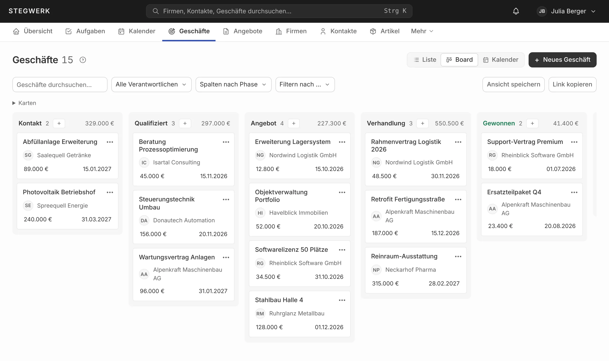
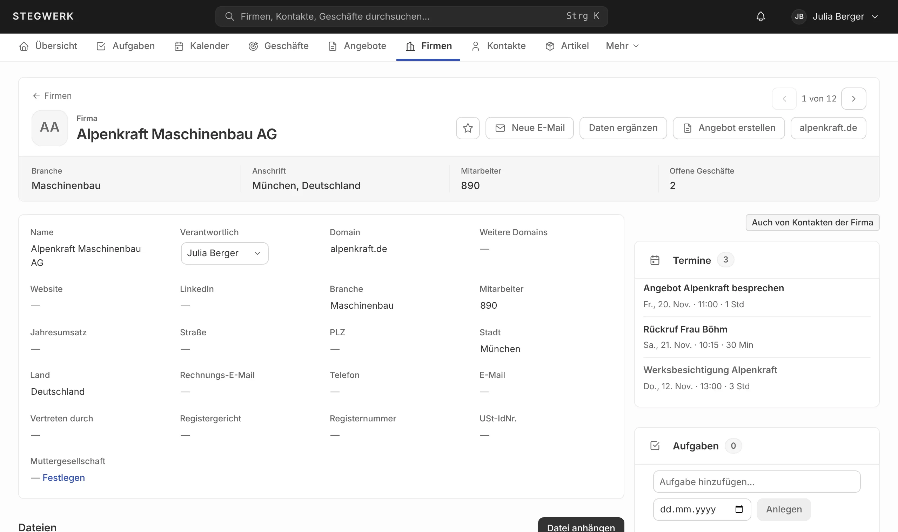
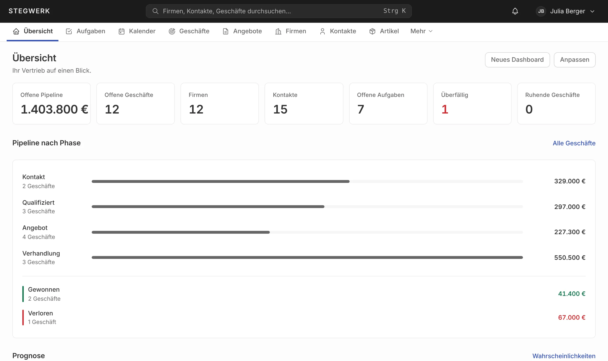
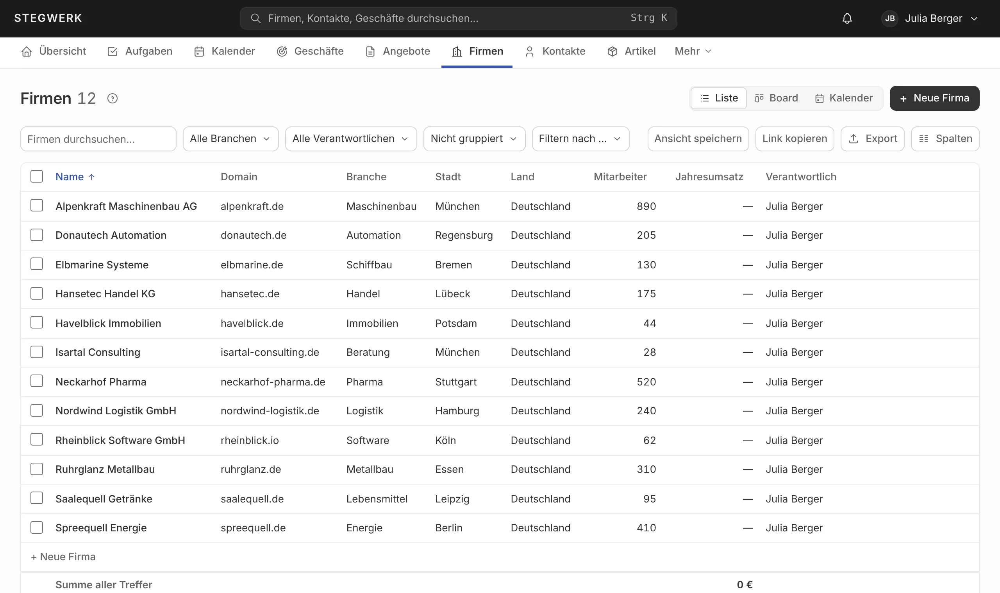
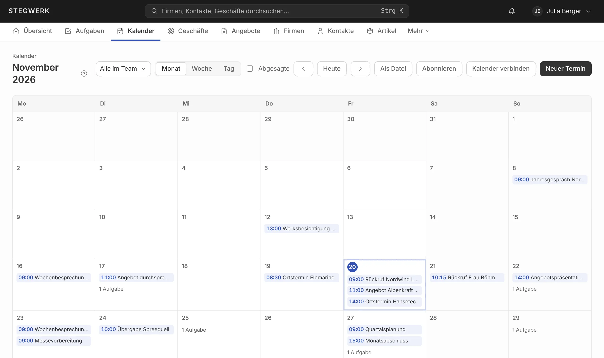

<h1 align="center">Stegwerk</h1>

<p align="center"><b>The open-source CRM for businesses in Germany.</b><br/>
From the first contact to the paid invoice: deals, quotes, GoBD-compliant invoices, XRechnung and DATEV in one self-hosted app.</p>

<p align="center">
  <a href="#self-hosting">Self-hosting</a> ·
  <a href="#features">Features</a> ·
  <a href="CONTRIBUTING.md">Contributing</a> ·
  <a href="docs">Documentation</a>
</p>

<p align="center">
  <a href="LICENSE"></a>
  
  
  
</p>

<p align="center">
  <picture>
    <source media="(prefers-color-scheme: dark)" srcset="docs/images/board-dark.webp" />
    <source media="(prefers-color-scheme: light)" srcset="docs/images/board-light.webp" />
    
  </picture>
</p>

<br />

# Why Stegwerk

Most CRMs stop at the deal. In Germany the work continues: a quote with the
right legal details, an invoice that satisfies § 14 UStG and GoBD, an
e-invoice in XRechnung or ZUGFeRD format, and an export your accountant can
import into DATEV. Small teams end up paying for a CRM *and* an invoicing tool
and typing the same data twice.

Stegwerk does both, runs on your own server, and keeps your customer data
where you decide. It is free, with every feature and no seat limit.

<br />

# Features

**Sales**
- Companies, contacts and deals with in-place editing, custom fields and custom objects
- Pipelines with your own stages, win probability and a forecast
- List, board (Kanban) and calendar views, saved views, filters, bulk actions
- Tasks, reminders, appointments with CalDAV sync and an iCal feed
- Duplicate detection and merge, trash with undo, full change history

**Quotes and invoices**
- Quotes with line items and online acceptance by link
- Invoices according to § 14 UStG, numbered and locked for GoBD
- E-invoices as XRechnung and ZUGFeRD, GiroCode (EPC QR) for bank transfers
- Recurring invoices, dunning with statutory interest, order confirmations and delivery notes
- DATEV export, sync with Lexware Office and sevDesk

**Email and automation**
- Connect IMAP mailboxes (also Gmail and Microsoft 365); mail appears on the right company and contact
- Shared mailboxes, templates, mass mailings with unsubscribe handling
- If-then automations, round-robin assignment, webhooks, a web form for your website
- Optional AI assistance with your own API key (OpenAI or Anthropic)

**Team and privacy**
- Roles and permissions down to field level, record-level sharing
- Two-factor authentication, sign-in with Google or Microsoft, session management
- GDPR tools: export, erasure, retention periods, audit log, data processing agreement
- No cookies for tracking, no third-party fonts, no analytics

**For developers**
- GraphQL API with API keys, webhooks and an MCP server for AI agents
- Clean TypeScript monorepo: NestJS, PostgreSQL, React

<br />

<table>
  <tr>
    <td width="50%">
      <picture>
        <source media="(prefers-color-scheme: dark)" srcset="docs/images/company-dark.webp" />
        
      </picture>
      <p align="center">Every company on one page: details, deals, people, mail and activity</p>
    </td>
    <td width="50%">
      <picture>
        <source media="(prefers-color-scheme: dark)" srcset="docs/images/overview-dark.webp" />
        
      </picture>
      <p align="center">Pipeline, forecast and what needs attention today</p>
    </td>
  </tr>
  <tr>
    <td width="50%">
      <picture>
        <source media="(prefers-color-scheme: dark)" srcset="docs/images/companies-dark.webp" />
        
      </picture>
      <p align="center">Lists with filters, saved views and inline editing</p>
    </td>
    <td width="50%">
      <picture>
        <source media="(prefers-color-scheme: dark)" srcset="docs/images/calendar-dark.webp" />
        
      </picture>
      <p align="center">Calendar with CalDAV sync</p>
    </td>
  </tr>
</table>

<br />

# Self-hosting

You need a Linux server with Docker and Docker Compose.

```bash
git clone https://github.com/<owner>/stegwerk.git
cd stegwerk
bash scripts/setup.sh                # writes .env.prod with random secrets
docker compose --env-file .env.prod -f docker-compose.prod.yml up -d --build
```

Open <http://localhost:8080> and create the first account. For a public
domain, pass it to the setup script (`bash scripts/setup.sh https://crm.example.com`)
and put a TLS-terminating reverse proxy such as nginx or Caddy in front of
port 8080.

Optional settings live in `.env.prod`: SMTP for outgoing mail, sign-in with
Google or Microsoft, your company details for the legal notice and privacy
policy, and error reporting with Sentry. Guides for operations are in
[`docs/`](docs): backups ([sicherung.md](docs/sicherung.md)), key rotation
([schluesselrotation.md](docs/schluesselrotation.md)), e-invoicing
([e-rechnung.md](docs/e-rechnung.md)), DATEV ([datev.md](docs/datev.md)) and
the API ([schnittstelle.md](docs/schnittstelle.md)).

`scripts/vps-deploy.sh` sets up a fresh Ubuntu server end to end: Docker,
firewall, nginx with Let's Encrypt, automatic security updates and encrypted
nightly backups.

<br />

# Development

```bash
npm install
npm run db:up                      # PostgreSQL 16 on localhost:5433
cp server/.env.example server/.env # set JWT_SECRET to a long random string
npm --workspace server run migration:run
npm run dev                        # API on :4000, web on :5273
```

Fill a workspace with sample data:

```bash
node scripts/seed-demo.mjs you@example.com your-password
```

See [CONTRIBUTING.md](CONTRIBUTING.md) for checks, migrations and conventions.

| Layer    | Stack                                              |
| -------- | -------------------------------------------------- |
| API      | NestJS 11, GraphQL (code-first, Apollo), TypeORM   |
| Database | PostgreSQL 16                                      |
| Web      | React 18, Vite, Apollo Client                      |
| Language | TypeScript, strict                                 |

<br />

# Language

The interface is in German, because the legal parts (invoices, GoBD,
XRechnung, DATEV) are made for Germany. An English translation is one of the
most welcome contributions.

<br />

# Contributing

Issues and pull requests are welcome. Read [CONTRIBUTING.md](CONTRIBUTING.md)
to get started and [SECURITY.md](SECURITY.md) to report a vulnerability.

If Stegwerk is useful to you, a ⭐ on GitHub helps others find it.

# License

Stegwerk is licensed under the [GNU Affero General Public License v3.0](LICENSE).
You may use, change and host it, also commercially. If you offer a modified
version to others over a network, you must publish your changes under the same
license.
